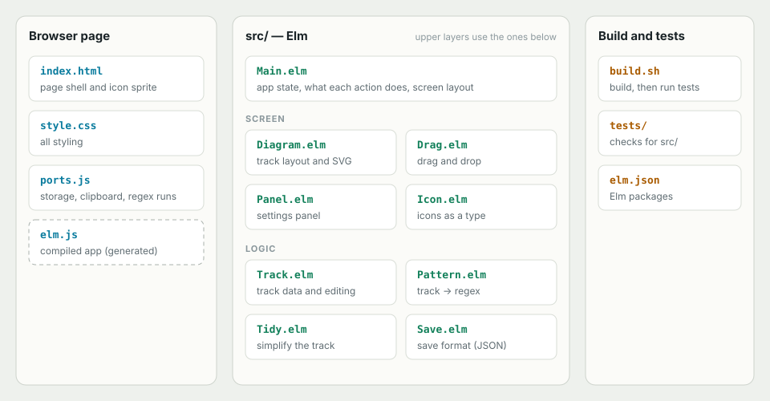

# Regex Tracklayer
Try me from [t92.jp/regex-tracklayer](t92.jp/regex-tracklayer)
Build regular expressions by laying stations on a railway track.
The track diagram and the regular expression always match, and you can try the expression on a test string as you go.

## The track

| On the track | In the regular expression |
| --- | --- |
| Station `abc` | text |
| Station `\d` `\w` `\s` `.` | character class |
| Station `[ ]` | character set (can be negated: `[^ ]`) |
| Parallel lanes | alternatives `(?:a\|b)` |
| Detour above a station | optional `?` / `{0,n}` |
| Loop line below a station | repeat `+` / `*` / `{n,m}`, with stations on the way back (`a(?:,a)*`) |
| Thin rail | lazy (`+?`, `??` …) |
| Signal (red / green, looking ahead / behind) | lookaround `(?!…)` `(?=…)` `(?<!…)` `(?<=…)` |
| Buffer stop at either end | anchors `^` `$` |

## Using it

- **Add a station**: drag it from the tray onto a gap in the track, or tap it to place it after the selection.
- **Make a branch**: drop a station from the tray onto a station already on the track, or use the branch button in the panel.
- **Draw rails**: drag from a gap. Up and to the right makes a detour, down and to the right a parallel lane, to the left a loop.
- **Move or delete**: drag a station somewhere else, or back onto the tray to delete it.
- **Settings**: select a station to change its text, how many times it repeats, lazy matching, negation or signal color.
- **Ends**: click `^` or `$` to anchor the start or the end.
- **Tidy** simplifies the track without changing what it matches. **Undo**, **Clear** and **Copy** do what they say.

The track and the test string are kept in the browser (localStorage).
Expressions use JavaScript's regular expression syntax.

## Build and run

Requires [Elm 0.19.1](https://guide.elm-lang.org/install/elm.html) and bash (Git Bash on Windows).

```sh
./build.sh            # builds elm.js, then runs the tests
./build.sh --no-test  # builds elm.js only
```

Then open `index.html` in a browser. No server is needed.

The tests run in headless Chrome or Edge and print a summary such as `1227 checks, 0 failures`.
Without either browser, open `tests/index.html` to see the results.

## Project structure



- `src/Track.elm`, `Pattern.elm`, `Tidy.elm` and `Save.elm` are plain logic with no screen, and are what the tests check.
- `tests/fixtures.js` holds results recorded from the original JavaScript version, so the regular expressions and tidying stay the same.
- `ports.js` is the only hand-written JavaScript: it covers what Elm cannot do on its own (storage, clipboard, running the regular expression in a Worker with a time limit, focus).
